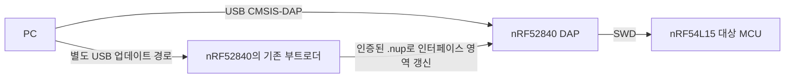

# DAP 펌웨어 트러블슈팅 리포트

작성일: 2026-10-25. 아래 시각은 한국 표준시(KST, UTC+09:00)다.

**결론:** 제공된 DAP 펌웨어 소스에서 SWD 연결 상태를 초기화하는 문제를 확인했다. 기존 DAP 펌웨어를 유지한 상태에서 호스트의 명시적 재연결로 COM3 접근을 복구했고, 이후 세 보드 모두 정상 초기화·정지·유휴 검사를 통과했다. 최초 13:22 연결 실패의 직접 원인은 아직 확정하지 못했다.

**작업 범위:** 사용자의 최종 지시에 따라 DAP 펌웨어 개발·추가 검증·업로드는 중단한다. 지금까지 **신규 DAP 펌웨어 업로드 0회, 부트로더 전환 0회**다. 아래 로컬 수정안과 오프라인 검사 결과는 DAP 담당자에게 전달할 조사 자료이며, 장치에 적용된 수정이나 DAP 문제 전체의 해결 완료를 뜻하지 않는다. 본 작업은 현재 펌웨어로 W06 검증을 이어간다.

## 1. 어떤 상황이었는가

NU54DK 세 대로 M33-W06 최종 검증을 진행하고 있었다. 대상 MCU는 nRF54L15이고, USB 디버거인 DAP는 별도의 nRF52840에서 실행된다. COM3의 디버그 접근이 실패하면서 다음 실기 시험을 준비하지 못했다.

#18 DFU 자체 시험은 통과했고, 그 직후 세 보드의 디버그 접근도 정상이었다. 문제는 **DFU 종료 후 다음 검증을 준비하는 과정**에서 관측됐다. 따라서 “DFU 실행 중 DAP가 멈췄다” 또는 “DFU가 DAP 장애를 일으켰다”는 인과관계는 확인되지 않았다.

| 구분 | 확인한 내용 |
| --- | --- |
| Core 진단 소스 | `57624a4ccc4717873c1fbe1d81ae537555876299`, 실행 전후 clean |
| 사용자가 제공한 DAP 소스 | `C:\Users\eidos\GitHub\FW_NU54DK_nRF52840_DAP` |
| 조사·빌드 사본 | `D:\w06\nu54-dap-source-20261025` — C의 DAP 원본은 변경하지 않음 |
| 제공 소스 보존 기준 | 로컬 baseline `64489f179f4715c9c18464bb9184df64f4153325` |
| COM3 DAP 설치본 | Build ID `cfff97fe68ecef855c30a82263b4d591b773016b`, Interface CRC `892efb69`, HIC `6e052840` |
| 모델 대조 | nRF52840 HIC·32자 USB serial 형식·간략 DETAILS 형식 일치. 설치 바이너리와 제공 소스의 정확한 동일성은 미확인 |

앞서 제공됐던 nRF52820 소스는 설치 모델의 정본으로 사용하지 않았다. D에서 만든 baseline 커밋은 제공 자료를 보존하기 위한 식별값이며, 설치 펌웨어의 기존 Build ID와 동일하다는 뜻이 아니다.

## 2. 어떤 문제가 있었는가

### 2.1 Reset-pin 요청이 SWD 초기화까지 실행하는 소스 결함

제공 소스의 `DAP_TargetResetPinHook()`은 물리 nRESET 핀 helper 대신 `swd_set_target_reset()`을 호출했다. Nordic family 경로를 거치면 다음 호출 관계가 성립한다.

```text
PC의 DAP_SWJ_Pins(nRESET 제어)
  → DAP_TargetResetPinHook()
  → swd_set_target_reset()
  → Nordic family reset 처리
  → swd_init_debug() → swd_init() → DAP_Setup()
```

`DAP_Setup()`은 DAP의 `debug_port`를 비활성 상태로 바꾸고 clock·transfer 설정도 초기화한다. 반면 PC의 pyOCD는 기존 SWD 연결 상태를 유지할 수 있다. 이때 PC는 이미 연결됐다고 판단해 `DAP_Connect`를 생략하지만, DAP 내부 상태는 초기화되어 양쪽 상태가 어긋난다. 연결이 비활성인 DAP의 transfer 경로에서는 정상 SWD 응답 대신 dummy 응답이 나올 수 있다.

이 **소스 결함과 호출 경로는 확인**했다. 다만 설치본이 제공 소스와 정확히 같은지는 미확인이므로, 모든 과거 장치 실패를 이 코드 하나로 확정하지 않는다. 근거: [baseline reset-pin hook](D:/w06/nu54-dap-source-20261025/baseline-source/source/board/nu54dk_v2_pre_release.c:735), [Nordic family reset](D:/w06/nu54-dap-source-20261025/baseline-source/source/family/nordic/target_reset_nrf52.c:151), [독립 인과관계 감사](D:/w06/nu54-dap-source-20261025/explicit-reconnect-causality-audit-attempt1.json).

### 2.2 전압 재감지에서도 같은 연결 상태를 건드릴 수 있음

`board_30ms_hook()`의 전압 low→high 감지 후 `refresh_target()` → `prerun_board_config()` 경로에서도 SWD 초기화·해제를 수행한다. 이 진입점에는 호스트의 SWD/JTAG 연결 또는 drag-and-drop flash 작업 중인지 확인하는 처리가 없었다.

연결·flash 작업 중에는 재감지를 유예하고 pending 상태를 보존하는 것이 검토한 수정 방향이다. D 사본에 최소 guard 초안을 작성하던 중 사용자의 중단 지시를 받았으며, 이 추가 변경은 **미커밋·미빌드·실기 미검증** 상태로 보존했다. 최초 장애 당시 전압 변화가 있었다는 측정 기록은 없으므로 그 장애의 직접 원인으로 단정하지 않는다.

## 3. 어떤 현상이 언제 발생했는가

| 시각 | 실제 관측 | 의미 |
| --- | --- | --- |
| 11:40:59 | #18 native DFU 양성 10회·음성 5×20회 PASS. 외부 group 증거 판정에는 `M30AttestationFailure` 발생 | DFU 동작 결과와 외부 validator 실패를 구분 |
| 11:42:44 | 세 보드 identity·HALT·strict idle PASS | DFU 직후에는 디버거 접근이 정상 |
| 13:22:12–16 | 과거 COM 매핑 불일치로 사전 검사 거부 | target session을 열기 전의 매핑 실패 |
| **13:22:44.290–47.752** | COM3 `board.init()` 내부 두 번째 DP 연결에서 DPIDR 읽기 `No ACK` | 초기 DP 연결·identity 검증 반환 후 full init에서 실패. 앞선 host pin reset 호출 없음 |
| 15:47:12 | 사용자 재연결 보고 이후 세 보드 strict idle 다시 PASS | 최초 실패 이후 계속 접근 불능이었던 것은 아님 |
| 15:48:41–15:49:40 | BAP 이미지를 COM18·COM8에 준비, `FLASH_PREPARED` | COM3 target session은 열지 않은 작업이며 최초 실패보다 뒤에 발생 |
| 15:49:44–47 | COM3 AP discovery에서 AP0 누락·`KeyError 0` | 같은 trace의 No ACK로 표현하면 부정확 |
| **17:08:31–32** | DPIDR·debug powerdown 확인과 pin assert/release 성공 후 full init에서 `Unexpected ACK 0` | 리셋 이후 연결 상태 문제를 조사한 후속 실패 |
| 17:20:33–38 | COM3 UART에서 M28 central 응답 78바이트 관측 | 대상 application의 실행은 관측됨. 현재 flash 전체 byte 동일성은 미확인 |
| **18:12:39–41** | 명시적 SWD 재연결 후 full identity·FICR/CPUID·HALT·strict idle PASS | 기존 DAP 펌웨어로 실제 접근 복구 |
| **18:17:27** | 원래 `backend.session` 경로로 세 보드 모두 PASS, `RESET=0` | 정상 초기화 경로에서도 복구 확인 |

최초 실패 시각은 수기 receipt 작성 시각인 13:27이 아니라 원시 도구 실행 기록으로 정정했다. 11:42~13:22 구간의 해당 채팅 도구 호출 179개에서는 추가 target program/reset/resume 기록을 찾지 못했다. 다만 연속적인 장치 감시가 없었으므로 정확한 장애 발생 순간이나 다른 프로세스의 활동까지 배제할 수는 없다. [원시 기록 대조 타임라인](D:/w06/final-57624a4c-actions61-attempt1/debugger-failure-timeline.json)

## 4. 코드의 어느 부분을 어떻게 수정·검토했는가

### 4.1 DAP 담당자 전달용 로컬 수정안 — 장치 미적용

`source/board/nu54dk_v2_pre_release.c`의 `DAP_TargetResetPinHook()`에서 다음 호출을 바꿨다. 수정은 D 사본의 로컬 커밋 `89ac684d659000ff81ba15bb91eac1bb204de6cb`에만 있으며, C의 제공 소스나 실제 장치에 적용하지 않았다.

```c
/* 변경 전: family reset 경로로 진입 */
swd_set_target_reset(asserted);

/* 검토용 변경 후: 기존 물리 GPIO helper를 직접 사용 */
board_swd_set_target_reset(asserted);
```

검토용 수정 함수는 다음과 같다.

```c
/**
 * @brief CMSIS-DAP의 핀 요청에 따라 물리 nRESET 핀만 제어한다.
 * @param asserted 0이 아니면 nRESET을 내리고, 0이면 해제한다.
 * @return 핀 요청을 처리했으면 1을 반환한다.
 * @note 기존 오픈 드레인 GPIO 설정을 유지하며 SWD 초기화는 호출하지 않는다.
 */
uint8_t DAP_TargetResetPinHook(uint8_t asserted)
{
    board_swd_set_target_reset(asserted);
    return 1;
}
```

기존 helper의 open-drain GPIO 설정과 핀 readback 동작은 유지했다. 이 변경은 일반 device reset, Nordic family 구현 또는 보안 업데이트 로직을 수정한 것이 아니다. [1차 수정 범위 기록](D:/w06/nu54-dap-source-20261025/reset-pin-patch-review.json)

### 4.2 실제 적용한 호스트 복구 절차

COM3의 실제 DPIDR와 debug powerdown을 확인하고 pin reset을 한 번 수행한 뒤, 다음 순서로 연결을 명시적으로 다시 설정했다.

```text
probe.disconnect()
probe.set_clock(500000)
probe.connect(SWD)
→ 기존 full init 및 identity gate
→ FICR/CPUID 확인
→ HALT·strict idle·WDT 확인
```

실제 `DAP_Disconnect`, clock 설정, `DAP_Connect`, transfer·SWD 설정 명령의 반환을 기록했다. 기존 초기화 task와 판정 기준을 유지했으며 erase/program/unlock/recover/resume 명령은 요청하지 않았다. 설치 DAP가 reset hook 내부에서 수행한 SWD 쓰기는 호스트가 직접 관측할 수 없으므로 “물리 핀만 조작했다”고 단정하지 않는다.

이 절차는 별도 진단 helper에서 실행했으며 Core 제품 코드나 W06 runner에 자동 재시도·리셋 우회를 추가한 것은 아니다.

## 5. 이후 동작은 어땠으며, 해결됐는가

| 검증 | 결과와 한계 |
| --- | --- |
| baseline 실제 빌드 ELF의 reset-pin 경로 | 500kHz·4MHz 모두 금지 family 함수 진입 감시에서 FAIL. 함수 내부 상태 훼손까지 끝까지 실행한 시험은 아님 |
| 로컬 1차 수정 ELF | 2 clock × 4개 동작, 총 8개 검사 PASS. DAP 상태 보존·GPIO 동작·readback 확인. 하드웨어 주변장치는 모델로 제공 |
| 기존 USB ELF 회귀 | 3개 PASS. 설치 장치의 USB 실기 검증은 아님 |
| secure update 단위·패키지 검사 | 기존 단위 10개·정적 패키지 37개 PASS. 설치 부트로더의 호환성이나 업로드 성공을 뜻하지 않음 |
| 기존 펌웨어의 COM3 명시 재연결 | full identity·FICR/CPUID·HALT·strict idle PASS, WDT `[0,0]` |
| 이후 세 보드 정상 초기화 | PASS3. CPU HALTED, RADIO=0, WDT `[0,0]`. 추가 reset/program/resume 없음 |
| DAP 새 펌웨어 장치 적용 | **미실행, 사용자 지시로 후속 작업 중단** |

**복구된 것은 실제 보드의 디버그 접근이다. DAP 수정 펌웨어가 장치에서 검증되거나 모든 장애 원인이 해결된 것은 아니다.** 명시 재연결 전후의 `CTRL/STAT` 초기 상태에는 READOK 차이도 있어 완전한 단일변수 대조 실험으로 과장하지 않는다. 제공 소스와 설치본의 동일성, 최초 13:22 장애의 직접 원인, 당시 전압 변화 여부는 미확정으로 남긴다.

보드·케이블 고장으로 단정할 근거는 없다. 과거 전체 삭제 후 LED 정상 동작 확인 이력을 보존했고, 이번 복구를 위해 전체 삭제나 LED 진단을 반복하지 않았다. 또한 이번 진단 성공으로 과거 STOP 실패나 W06 제품 시험 실패를 PASS로 바꾸지 않았다.

## 6. DAP 자체 업로드 경로에 관한 설명



제공 소스에는 `start_bl.act`로 기존 USB 부트로더에 진입하고 인증된 `.nup` 파일로 DAP의 인터페이스 펌웨어를 갱신하는 기능이 있다. 따라서 정상 부트로더가 이미 설치돼 있다면 외부 SWD 배선 없이 갱신할 수 있는 구조다. 빈 칩이나 부트로더 손상 상태에서는 이 경로를 사용할 수 없다.

이는 **소스에서 확인한 구조 설명**이다. 현재 장치에서 해당 부트로더 경로를 시험하거나 파일을 업로드하지 않았으며, 사용자의 최종 지시에 따라 앞으로도 이번 작업에서 실행하지 않는다.

## 7. 인계 및 증거

DAP 담당자가 검토할 항목은 reset-pin 경로의 GPIO 전용 처리와 전압 재감지의 연결 소유권·pending 처리다. 장치 적용과 추가 펌웨어 검증은 이번 W06 작업 범위 밖으로 남긴다. W06에서는 현재 DAP를 유지하고 기존 identity·STOP·유휴·단일 writer 기준에 따라 다음 실기 검증을 진행한다.

아래는 이 PC의 로컬 증거다. 원본 FAIL을 보존했으며 인증 키와 원시 probe UID는 보고서에 포함하지 않았다.

| 자료 | SHA-256 |
| --- | --- |
| [실패 타임라인](D:/w06/final-57624a4c-actions61-attempt1/debugger-failure-timeline.json) | `915747df57f7e97f84968f6bd380ddb4313617c3c1e5c1f6c575d18f2d18f947` |
| [baseline ELF FAIL](D:/w06/nu54-dap-source-20261025/reset-pin-baseline-elf-attempt1.json) | `4a7175d321dc8fe58edf1954917826471a4d5b08b1766dfbbee1e4516052ac93` |
| [로컬 수정 ELF PASS](D:/w06/nu54-dap-source-20261025/reset-pin-patched-elf-attempt1.json) | `f3d0a7cad96629f34d230b290515e4e48e0397df57a043a83e859870e196fe45` |
| [COM3 실제 재연결 PASS](D:/w06/final-57624a4c-actions61-attempt1/explicit-connect-after-pin-reset-attempt1/result.json) | `450751f8dae89cab456ba5ad251392fb93294a2a4cd10b819e6b551162c42806` |
| [세 보드 정상 세션 PASS](D:/w06/final-57624a4c-actions61-attempt1/all3-strict-idle-after-explicit-reconnect-attempt1.json) | `c0bf7ab9ac49d28c4e37645c7484b6d0e61181622c8e12c7756d2f0e965b12cd` |
| [독립 인과관계 감사](D:/w06/nu54-dap-source-20261025/explicit-reconnect-causality-audit-attempt1.json) | `0d457b6d29c4dbd73aba8ef8982e432bfafd61a5d3b95112b17684549e63cd80` |
| [사용자 지시에 따른 DAP 작업 종료 기록](D:/w06/final-57624a4c-actions61-attempt1/dap-scope-closed-user-instruction.json) | `395ad1d3d1c9ee05c5d4a540da8225dae497ec82a11fadd7b79c4158ce257335` |
